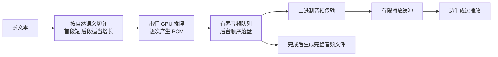

# 长文本语音生成与即时播放优化策略

日期：2026-10-16
状态：方案，尚未实施流式播放
首批范围：Windows 桌面版、已安装 CUDA 后端、Qwen Base 克隆声音

## 1. 产品目标

用户一次粘贴长文本后，系统应尽快开始朗读，继续在后台生成后续内容，同时保存完整音频。首音等待时间不应随全文长度近似线性增长。

同时优化三个指标：首次出声延迟、持续播放的连续性、完整音频的生成效率。缩短首次等待不代表生成算力已经提升，增大缓冲也不能长期弥补生成速度低于播放速度。

已有的进度与缓存更新可以继续使用，但尚未解除“全部生成后才播放”的限制。

## 2. 已核实的现状与基线

| 环节 | 当前实现 | 对等待时间的影响 |
| --- | --- | --- |
| 文本分段 | `backend/utils/chunked_tts.py`，默认每段最多 800 字符 | 分段用于推理稳定性，未把音频段实时交给播放器 |
| 推理结果 | `backend/backends/pytorch_backend.py` 调用 `generate_voice_clone()` | 单段仍然等待完整波形 |
| 长文本编排 | `backend/services/generation.py` 等待 `generate_chunked()` 返回完整结果 | 后续归一化、音效、保存均在整段结果之后 |
| 流式 HTTP 接口 | `backend/routes/generations.py` 的 `/generate/stream` 先生成完整 WAV 再分块发送 | 不能缩短模型生成期间的首音等待 |
| 播放 | `app/src/components/AudioPlayer/AudioPlayer.tsx` 使用 WaveSurfer WebAudio，等待解码 ready | 需要增加增量播放路径 |
| 特定输出设备 | `tauri/src/platform/audio.ts` 的 `playToDevices()` 接收完整音频数据 | 直播虚拟声卡和多设备输出还需要原生增量播放支持 |
| 模型能力 | 仓库内 Qwen 封装提供 `stream_generate_voice_clone()`，可逐次产出 PCM | 是候选接入点，尚无此项目流式音质与性能验收结果 |

本次已安装版本的验收样本：

- RTX 5070 Ti，Qwen 1.7B，195 个中文字符，按 100 字符上限拆成 3 段。
- 总等待 60.53 秒，生成 38.01 秒音频；包含冷模型加载及首次推理成本。
- SSE 首次观察到第一段完成约在 34.4 秒，时间精度受约 1 秒的状态采样间隔影响。
- 后续一条短句用时 5.17 秒，生成 5.19 秒音频，单次实时系数约 0.996。

证据：`release/local-generation-progress-20261016-124307/live-smoke.json`；后续短句计时来自已安装后端阶段日志。两个样本不足以推断长时间持续生成性能。

即使现在直接把第一段交给播放器，这次冷启动样本仍需等待约 34 秒。必须同时解决模型内部输出粒度、冷启动和播放链路。

## 3. 推荐架构

文本分段是模型的上下文与质量边界；PCM 音频包是播放与传输边界。两者独立：即使首段文字尚未全部合成，也应能够播放该段已经产生的声音。

保留当前单 GPU 串行推理策略，首先实现推理、传输、落盘与播放的重叠执行。多个音频段同时争抢同一模型/GPU 不作为默认加速方案。

## 4. 实施顺序

### 第一步：验证 Qwen 内部流式输出，决定可用路径

这是最优先的一个交付物：同一声音、同一文本，从模型产生首包到 Windows 实际出声的最小验证，以及冷、温、热启动测量报告。

1. 在隔离测试环境接入 `stream_generate_voice_clone()`，记录每个 PCM 包的生成时间、采样率、样本数、累计时长。
2. 先建立关闭可选编译/优化解码的稳定基线，再与当前 `codebook-safe` 配置对照。不能假定现有离线编译收益会直接适用于流式路径。
3. 测试 `emit_every_frames` 的 4、8、12 等候选值与不同解码窗口。更频繁输出可能增加解码开销，应同时比较首包延迟与总体实时系数。
4. 对照非流式结果检查读字完整性、参考录音前缀泄漏、首尾截断、重复字、爆音、语速和声音一致性。不要求采样模式下两种路径逐样本一致。
5. 若原生流式有质量或性能阻碍，先交付“按自然短句生成，完成一句便播放一句”的降级版本，同时保留原生流式作为后续优化。降级路径不得宣传为模型级实时输出。

第一步完成标准：产出一条真正提前播放的长文本录音与计时日志；验证失败时给出明确原因、可用降级路径和实测等待时间。

### 第二步：打通逐包播放与后台保存

后端任务成为唯一音频生产者；试听连接读取该任务的输出，不能另起一遍模型推理。

- 为支持的后端增加明确的流式能力标记与 `generate_stream()` 接口。暂不将 Qwen Base 的能力视为全部引擎均可用。
- 同步模型生成器放在受控工作线程中运行，PCM 通过有界队列交给服务主循环，服务仍能响应进度、暂停、取消等操作。
- 建议新增二进制音频连接，复用现有 SSE 传状态。首条元数据声明格式、采样率、声道；每包带序号与绝对样本偏移。已有下载型接口保持原语义，避免破坏调用方。
- 输出 PCM 随生成顺序写入临时文件，完整成功后封装 WAV、原子提交并更新历史记录。避免长文本所有波形同时驻留内存。
- 暂停试听时，生成可继续落盘；限制前端预取量。客户端缓冲达到上限后暂停发送，后续从已落盘的样本偏移继续读取，避免无限队列或无限 RAM 缓冲。
- 连接断开不自动让整项生成失败。重连从已确认的样本偏移恢复，丢弃重复包；真正取消任务使用显式取消命令。

前端增加独立的增量播放器。优先验证 Web Audio + AudioWorklet 的 PCM 队列；它在音频渲染线程执行，可用于连续填充输出缓冲，但 WebView2 的实际行为必须实机验证。[MDN 文档](https://developer.mozilla.org/en-US/docs/Web/API/AudioWorkletProcessor)

WaveSurfer 继续用于完成后的完整波形与回放。生成期间显示已经生成、已经播放的范围；尚未生成的部分不可拖动。当前正在试听的任务完成后，不应被现有自动播放逻辑从头再播一次，切换到最终文件时保留播放位置。

默认音频设备和指定设备必须分别验收。直播虚拟声卡/多设备路由需要在 Tauri 原生音频层增加增量队列；未完成前明确提示能力限制，不能静默改用默认扬声器。

### 第三步：首段优先，后段自适应

先拿首段调用模型，无需等待全文做复杂分析或全部预处理。全文基础校验和轻量分段可以提前完成，但不能先对整篇做耗时改写或音频预处理。

中文调参起点：首段约 20–40 个字符，优先取完整短句；后续约 100–200 个字符。上述范围是实验参数，不是固定产品规则。英文等语言按词数、token 数或预计朗读时长配置，不能直接照搬中文字符数。

首段使用独立的内部预算。当前请求字段 `max_chunk_chars` 下限为 100，不能仅把前端数值改成 20–40 后发送，否则会触发参数校验失败。

分段规则：

- 优先在句号、问号、感叹号等自然边界切分，必要时使用分号、逗号。
- 保护小数、日期、缩写、引号及语气标签；文本去空白或规范化后保留原文位置映射。
- 没有标点的超长输入设置兜底长度，避免首段仍然成为整篇。
- 每段复用相同声音条件、语言、风格和规范化规则，避免为了首音速度造成声音跳变。
- 播放缓冲偏低时，倾向更早交付后续声音；缓冲充足时可适当增大后段，减少重复调用成本。调整依靠实测，不能仅根据字数推断生成速度。

### 第四步：预热与持续速度优化

预热应覆盖实际推理路径，而不只是 import 模型依赖。选择声音后，在无活跃任务且显存允许时，异步加载对应模型、准备声音特征并执行隐藏的短推理。预热样本不自动播放、不进入生成历史；切换声音的预热请求做防抖。

UI 区分“模型已加载”和“已完成推理预热”。测量三种状态：进程/模型冷启动、模型已加载但尚未执行对应路径、同配置已完成预热。不能把冷启动成本隐藏到测量之外后宣称所有请求都达到热启动延迟。

持续速度优化按测量结果推进：

1. 分别记录文本前处理、Talker/Code Predictor、音频解码、CPU/GPU 同步、传输和播放缓冲耗时。
2. 对比稳定执行与局部编译，检查可变文本长度造成的重新编译。项目已有 CUDA Graph 相关失败记录，新增配置需要连续多段验收；PyTorch 的 `reduce-overhead` 也不是对所有程序都保证降低开销。[PyTorch 2.11 文档](https://docs.pytorch.org/docs/2.11/generated/torch.compile.html)
3. 若 Qwen 1.7B 的流式实时系数仍接近或超过 1，再对比 0.6B 的速度、中文准确性和声音还原质量。更小模型、量化或新推理引擎都必须先验证，不能直接承诺提速。
4. 0.6B 也达不到持续速度标准时，再评估其他低延迟引擎。云端作为可选方案，需另行考虑声音支持、数据传输与使用成本。

## 5. 播放缓冲和算力余量

实时系数 RTF = 生成耗时 / 所生成音频时长。稳定连续播放需要长期 RTF 小于 1，并给文本差异、解码和系统调度留出余量。

例如 RTF=1.2 时，10 秒内只能生成约 8.3 秒音频，播放缓冲净减少约 1.7 秒。缓存 1 秒只能推迟卡顿，不能保证整篇连续朗读。

初始播放缓冲以 0.4–0.8 秒作为候选参数；网络抖动或实测生成波动较大时允许增加，并如实显示“缓冲中”。本地播放包间隔和最小可行缓冲由实验决定，不能把“包越小越快”作为固定结论。

暂停只改变播放状态；停止生成应同时清空待播数据、停止后续文本推理。取消协程不能视为同步 GPU 工作已结束，必须等工作线程确认退出后再允许下一任务占用模型。

## 6. 音质、失败和完整文件语义

- 已播出的声音无法撤回。尚未发送的段可以重试，已经播放的前缀不能通过透明重试再播一次。
- 音频包之间检查样本连续性与首尾处理。需要跨段淡化时预留短尾缓冲，在两段都就绪时拼接，不能对已播放的尾部再次交叉淡化。
- 实时试听可以使用有状态的增益/音效处理；全篇峰值归一化及需要完整输入的音效留到导出。试听与导出的处理差异要明确，避免最终文件音量或时长突然改变却无说明。
- 生成状态与播放状态独立：生成可能已完成但尚未播完，也可能仍在生成但用户已暂停。播放完当前缓冲不等于生成完成。
- 中途失败保留可恢复的临时段，显示“已生成部分内容”和失败位置；默认完整音频成功状态只能在落盘校验、文件提交成功之后出现。
- 同时保持可重播任务的配置、段落计划、随机种子及参数记录；同一路径内可复现，跨流式/非流式路径不承诺逐样本一致。

## 7. 量化验收

下表为拟定目标，尚非已实现能力。范围先限定为单个活跃任务、预热完成、Qwen 克隆声音、Windows + RTX 5070 Ti；未通过时应调整方案并报告实测值。

| 指标 | 定义 | 拟定目标/判据 |
| --- | --- | --- |
| 点击到实际出声 | 从提交到第一个包含有效语音的样本开始播放；不能用 HTTP 首字节代替 | 热状态 P50 ≤2 秒、P95 ≤3 秒，作为原生流式方案的实验目标 |
| 长度敏感度 | 相同开头、相同声音，正文分别为 200、2000、10000 字 | 首音延迟不随全文长度近似线性增长；单独报告前处理成本 |
| 持续生成余量 | 多段长文本持续生成耗时 / 音频时长，不含预热 | 以 RTF ≤0.75 为目标；接近/超过 1 不判定为连续播放达标 |
| 连续播放 | 2000 字及以上样本，覆盖至少 5 分钟音频 | 预热和初始缓冲之后不发生非预期断音；记录每次 underrun |
| 停止播放 | 用户点击停止到输出静音 | ≤200 毫秒的拟定目标；模型退出耗时另行记录 |
| 内存 | 持续运行、暂停、断连时的前后端缓冲 | 缓冲有上限，长文本不因全量波形留在 RAM 导致线性增长 |
| 内容完整性 | 已播放与保存内容 | 无丢字、重复、乱序、参考前缀泄漏、首尾截断；失败不误报完整成功 |

测试集覆盖：短句、195 字既有样本、2000/10000 字、无标点长段、数字与英文混排，以及取消重建、断线恢复、切换声音、后台页面、指定输出设备。

P50/P95 需在固定配置重复测量后统计；同一文本长度至少 20 次热运行用于首轮筛选，P95 结论再扩大样本量验证。冷启动与预热中请求单独列出，不混入热状态结果。

## 8. 第一项可验收交付

2026-10-16 更新：可选原生 PCM 即时试听已实现并安装到本机，代码与实测见 [STREAMING_PREVIEW_RESULTS.md](./STREAMING_PREVIEW_RESULTS.md)。以下验收目标仍需逐项以该报告的数据判断，不能将功能接通视为实时性能目标全部达成。

优先制作“Qwen Base 原生 PCM → 有限缓冲 → Windows 实际出声”的最小版本，选用现有声音与固定长文本，产出首音时间、每包间隔、RTF、音频正确性和冷/温/热启动对照报告。

这项交付验证通过后，再扩展完整历史管理、音效、多设备路由与其他引擎。若生成速度或音质不通过，首先解决模型路径或选择可接受的短句播放降级方案，避免先铺开全部界面和协议再发现模型无法满足连续播放要求。
