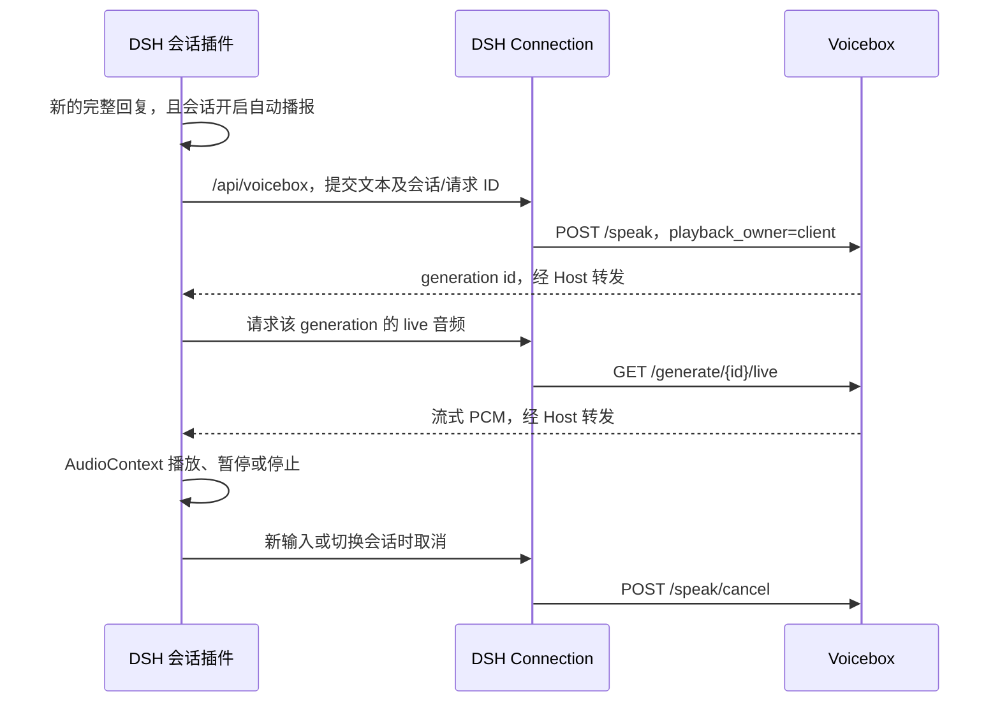

# DSH Voicebox

通过 DSH 官方 Cordis 插件机制，在 DSH Desktop 的对话栏内播放 Voicebox 合成的语音。

自然语音对话方案见 [设计文档](DESIGN-voice-interaction.md)。首版已接入会话表达策略、详细展开计划、实际播放位置和输入区控制条；跨重启精确恢复、完整语义覆盖和所有场景的人耳验收仍未完成。

当前候选版本为 `0.2.0-beta.2`，未发布到 npm / GitHub Release。预构建包的支持条件、安装和回退步骤见 [安装指南](INSTALL.md)，阶段目标与验收门槛见 [推进计划](ROADMAP.md)。

## 使用体验

- 每条已完成的 AI 回复下方，在复制按钮旁提供喇叭图标，点击朗读对应回复。输入框上方提供“语音对话”入口和“自动朗读：开 / 关”按钮，状态直接显示在按钮文字中。
- 单条回复的按钮状态为喇叭、生成中旋转图标、播放时停止图标；对应回复下方显示播放时间，提供暂停、继续和停止。点击另一条回复会停止之前的播放。
- 自动播报默认关闭，开关按会话保存在当前客户端。
- 自动播报方式可选“完整回复后朗读”或“边回答边读”。前者保留原有行为，后者从当前生成尝试的正文增量中分句，完整句子积累到约 24 字符，或自然逗号处积累到约 20 字符即开始合成；较长的无标点段落按不超过约 80 字符分段。
- 两种模式均使用 Qwen 流式 PCM。边回答边读跳过推理、工具参数、代码、图片、链接地址及管道表格；未闭合的 Markdown 构造继续等待后续文字。正文可能包含工具调用前可见的说明文字。
- 分句按顺序播放，最多同时保留一个正在播放的任务和一个预取任务；待处理文本最多八批，总朗读上限 10000 字符。回答结束只补齐末尾，不会重新朗读整篇。
- 生成期间，输入区提供边回答边读的暂停、继续和停止；回答结束后，控制回到对应回复下方。暂停会跨语音片段保留，点击停止后同一轮剩余文字也不再自动播报。
- 如果模型重试、放弃当前生成、正文改写或连接重建，会停止并丢弃本轮未播放的内容；完成后可手动朗读，避免重试从头自动重播。
- 切换 DSH 内部会话、发送新消息或关闭自动播报时停止播放。切到其他应用窗口或最小化 DSH 后，当前选中的普通会话仍会继续自动播报，边回答边读也会继续接收后续正文；切回窗口不会重复朗读。
- 恢复历史、重连、分页加载和子智能体不会自动播报。已加载的历史回复可通过各自的喇叭手动朗读。

## 前提

1. 使用本仓库包含本次集成修改的 Voicebox 后端，已经配置可供 Qwen 使用的音色及模型。
2. `/speak` 的 OpenAPI 必须包含 `request_id`、`stream_audio`、`preview_mode` 和 `playback_owner`，并提供 `/speak/cancel`。版本号 `0.6.0` 本身不能证明这些能力已安装。设置中的“检查安装条件”可只读检查接口、CUDA、模型缓存和声音档案。
3. Voicebox 后端默认监听 `http://127.0.0.1:17493`。可在插件配置里指定其他地址。

DSH Desktop 负责实际播放；Voicebox 主窗口和悬浮窗不会同时播放这条回复。

## 构建和安装

从 Voicebox 仓库构建客户端，无需安装新的 TTS 引擎：

```powershell
cd D:\Projects\Voicebox\integrations\dsh-voicebox
bun install --ignore-scripts
bun run build
```

在 DSH Desktop 中打开“插件 → 添加插件”，选择本地目录：

```text
D:\Projects\Voicebox\integrations\dsh-voicebox
```

也可以安装预构建的 `dsh-voicebox-0.2.0-beta.2.tgz`，以目标版本的插件安装器支持的输入为准。首次安装与更新应使用 Desktop 自己的插件入口，不直接修改它的 profile 或内置文件。

安装后，在 Voicebox 设置中为客户端 `dsh-voicebox` 绑定默认音色，或填写插件的 `profile`。打开普通会话，点击输入区的“自动朗读：关”开启，随后发送一条消息。点击开关或回复下方的喇叭，也会完成浏览器音频权限所需的用户手势。

如果重启客户端后浏览器仍要求手势，点击“朗读”即可重新启用音频。

## 插件配置

### 本地诊断

插件设置中的“本地语音诊断”可导出当前窗口最近最多 512 条技术事件：正文首段、合成请求接受耗时、播放器收到首包、AudioContext 播放推进、恢复时发现的调度断粮、识别与插话结果。
记录只保存在内存，包含相对耗时和有限的模型 / 输出策略选项，不含录音、转写、回复正文、原始错误信息、声音 / 会话 / 生成 ID、服务地址或设备名称；不会自动上传。点击“导出诊断”才生成 JSON 并请求下载，同时显示可复制的只读快照。清空、刷新或卸载会移除内存记录和页面快照；已保存的文件或剪贴板内容由用户管理。

文件中的 `request`、`piece`、`input` 是合成请求、播放片段、录入各自的局部序号，不能跨类别当作同一个任务 ID。计数包含上次清空以来的事件，超过容量时只有较早的事件明细被省略。

`pcm.first` 是播放器读取首个完整 PCM 包的时间；预取音频可能已由后端生成，不能当作模型首声延迟。`pcm.ready` 表示实际音频储量已满足开播条件，`bufferedMs` 是已收到的 PCM 时长。`pcm.started` 是 AudioContext 时钟越过计划起点的采样观察，间隔约 50–100 毫秒，不能证明蓝牙音响已经出声。`pcm.underrun` 在新包到来、发现旧调度已耗尽时记录空档、恢复留白及实际储量；DSH 使用 40 毫秒留白，未启用实际储量的旧客户端保留 300 毫秒。该事件不能单独区分推理、网络或主线程延迟，暂停与正常 EOF 不计入。已开始但尚未恢复的停顿，可结合 `speaker.state` 与后续失败事件检查。

### 连续语音对话（第一阶段）

1. 本次升级新增宿主路由和配置字段，先重启一次 DSH Desktop。
2. 在 Voicebox 中下载 Whisper 识别模型；插件默认使用 Whisper large-v3 turbo、中文，并将中文转写统一为简体。没有缓存的模型会提示先下载。
3. 打开普通聊天会话，点击输入框上方的“语音对话”，授权麦克风。新会话选好工作区后即可直接开始，不必先发送文字；尚未选择工作区时，先按 DSH 的提示选择工作区。说完停顿后自动转写并发送，回答会自动边生成边读，结束后回到监听。
4. 输入框上方使用紧凑粒子球与图标操作：麦克风切换静音、声波图标“打断并说话”、播放 / 暂停、电话图标结束。录音时出现“说完了，发送”箭头；悬停可查看按钮名称。下箭头展开转写与语音详情，参与正常布局，不覆盖正文。结束、切换 DSH 内部会话、保存配置或关闭页面会释放麦克风；结束语音不会撤销 DSH 已执行的工具操作。

语音模式临时启用流式播报，不会修改原有的自动播报开关或播报方式。设置中的“语音对话与麦克风”可配置识别模型、识别语言、中文简繁、麦克风、停顿耐心、插话、后台监听和语音过渡提示。控制条详情显示本轮实际使用的识别模型。

中文过渡提示用于语音对话，也用于已开启自动朗读的会话；在等待回复时使用“我想想”，自然句末或逗号、冒号后的分句等待时使用“嗯”。当前音色的两段短素材在空闲时准备，明确选择声音时缓存在本机；缓存未准备好时保持安静。等待约 1.1 秒才触发，提示间至少 15 秒，每个响应最多三次。过渡音在正文已具备实际开播储量后让位，收到首个小音频包不会提前切断它。正文、插话、暂停与结束优先；无标点的长度切割和句中 PCM 断流不插词。这能减少部分等待的突兀感，不能提升语音模型的合成速度或保证消除所有停顿，可随时关闭。

粒子球区分等待聆听、正在录音、识别 / 确认插话、模型回答、语音生成与实际播报；文字仍显示真实状态，暂停或仅麦克风静音时保持静止。麦克风静音但仍在播报时，继续显示播报动画。动画是状态指示，不是实际音量波形。单色 Canvas 根据宿主文字颜色适配明暗和自定义主题；系统开启减少动态效果时显示静止帧，移出可见区域或页面隐藏时暂停绘制。动画生命周期不控制音频或麦克风。

动画使用 [Thinking Orbs React 原作](https://github.com/Jakubantalik/thinking-orbs) `0.3.1`（MIT，Jakub Antalik），由用户参考的 [ThinkingOrbs Swift 移植版](https://github.com/haplollc/ThinkingOrbs) 找到原作。组件打包在插件中，本地绘制，不访问动画服务器或 CDN；授权文本随插件保存在 `third-party/THINKING-ORBS-LICENSE.txt`。

中文简体转换采用本地打包的 [OpenCC](https://github.com/nk2028/opencc-js)，在发送给 AI 前执行，字幕与发送文字一致；设置为“保留识别原样”可关闭。仅在明确选择中文识别时应用，其他语言及自动检测保留原样。字形转换不会纠正听错的词。

### 插话与恢复

自动插话默认关闭；语音对话期间仍可点“打断并说话”，立即停止播报、请求取消正在生成的回答并开始说新问题。此按钮也会解除麦克风静音。

在“语音对话与麦克风”中开启“允许说话打断（实验）”后：

1. AI 回答期间检测到约 450 毫秒持续声音，先暂停播报并保留播放进度，继续录下这句话。
2. 停顿后显示“正在确认插话…”。转写得到有效新文字才停止旧语音，通过官方 `cancel()` 取消仍在生成的回答，再以同一个 `beginSubmission` / `prompt` 请求标识提交新问题。取消失败不会提交或自动重试。
3. 空识别、明确匹配播报文字的疑似回声或识别失败，恢复原播放进度，保留旧回答。确认阶段识别最多等待 15 秒。用户原先手动暂停的语音保持暂停。
4. 静音、结束、切换会话或替换回答会丢弃迟到的插话结果，不会恢复另一条语音。AI 已经回答完、仅剩播报时，只停止语音，并按普通新问题提交。

播报期间自动插话要求设备报告已启用浏览器回声消除；无法确认时提示使用“打断并说话”。目前仍采用能量与持续时间判断，尚无语义 VAD。文字回声过滤只识别规范化后至少 8 个字母或数字、且连续包含于当前播放片段的文字；它不能识别所有回声，也可能忽略用户原样引用的长句。需要引用原文时可先点手动按钮。建议先用耳机验收，再试外放。

默认允许后台监听；关闭该选项后，窗口失焦暂停麦克风输入，已有播报继续。当前按停顿后整段转写，默认等待 2.4 秒静音，可调为 1.2 或 4 秒；录音时可点“说完了，发送”。单段保护上限延长至约 60 秒，达到上限仍会提交，尚不支持边说边显示文字或语义断句。插话记录消息/轮次及已播毫秒数，并向主模型提供实际正在播和最近播过的文本，但不截断原会话内容，因此还不能等同于端到端实时语音模型。

开启语音时，通过当前安装版本的官方 `systemPrompt.context` 向当前会话主模型提供口头表达策略。普通答复按问题决定详略；表格、代码留在正文，同时要求配有解释。结构上只有工件而没有说明时，自动补充一次解释，不另设摘要模型，不强制半分钟结束。内容是否充分、解释是否准确仍依赖主模型。

“全部详细讲一遍”会从上一答复的可见原文建立有限章节计划，通过会话作用域的 `voicebox_progress` 登记模型已经解释的单元；未解释部分通过官方 AgentLoop 下一步消息自动接续，消息来源明确标为插件，不冒充用户。最多自动接续 8 次，连续两次未取得进展则停止并提示尚未完整。“暂停”“继续播放”和回答中的简单“嗯”可在本地处理；明确纠正仍提交给模型。局部追问优先关联实际播到的文本。

局部追问可以来回交流，原详细计划会保留。当前模型通过 `voicebox_branch` 登记继续等待、接回原讲解或换题放弃；多轮讨论没有登记结束时，不仅凭队列为空擅自接回。接回仍须等当前回答实际播放完成，且没有新录入或暂停；模型明确等用户回答时，简短的“好”会作为回答提交。此工具只在挂起原计划的语音会话中提供，语义判断质量仍取决于当前模型，实际范围见 [VERIFICATION.md](./VERIFICATION.md)。

章节解释登记与音频播放回执分开：只有分句实际播完且该步正文已结算，才登记为播放完成。合成完成、排队完成和模型自报完成均不等于播完。计划和播放回执仅保存在当前进程，结束语音会释放会话策略；刷新或重启后不保证精确续播。详细语音队列仅将同一步内、已经积压的相邻短句合并至不超过 80 字，减少重复启动合成；首句不等待凑批，不跨步骤合并，中断批次不登记已播完。整轮文本保护为 20 万字符，单步流式正文仍为 3 万字符，触及限制明确报未完成。

麦克风输入经过官方 Connection 路由，以受大小限制的 16 kHz 单声道 PCM WAV 转发给 Voicebox `/transcribe`。识别模型与语言由宿主配置指定；收到迟到结果、识别失败或消息提交失败时不会自动重发。麦克风录音不在插件中持久保存。

### 共用播报参数

在 **插件 → dsh-voicebox → 语音播报设置** 中修改后点击“保存设置”。适配 DSH Desktop 0.2 的官方 `plugins.bundle.config` 插槽及 `configForms`，设置写入当前 DSH profile，重新打开后仍保留。保存会停止当前语音，下一次手动或自动朗读使用新参数。

- **语音模型**：Qwen3-TTS Base 0.6B / 1.7B。
- **自动播报方式**：完整回复后朗读（新安装默认）/ 边回答边读；手动朗读始终读取所选完整回复。
- **语音输出策略**：低延迟流式（默认）/ 整段检查后播放。此项决定声音是否需要等待整段检查，与等待 AI 完整回复的开关独立。
- **声音档案**：从已保存的 Voicebox 后端地址实时读取，保存稳定的档案 ID；可刷新列表，或选择跟随 Voicebox 客户端绑定。当前引擎不支持的设计声音、预设声音显示为不可选。
- **朗读语言**：跟随档案，或显式选择中文、英文等语言。
- **连接与会话范围**：后端地址、客户端标识及会话白名单。

改动先留在表单中，保存时以开始编辑时的配置版本做一次原子写入。其他窗口先修改了配置时，本次保存会拒绝覆盖，并保留草稿。地址变更后请先保存再刷新声音列表。模型下载及声音档案创建仍在 Voicebox 中完成。

首次升级包含宿主代码的插件版本后，需重新启动 DSH；日常参数修改实时生效，无需重启。

CUDA 播报默认恢复增量输出：模型每生成一批 PCM 就交给播放器，保留重复惩罚、正常结束与帧数上限、采样有效性、累计时长和严重削波检查。发生异常即停止，不会重播已出声的内容；这类即时检查不能提前排除所有音色变形或错读。

选择“整段检查后播放”时，每段最多约 80 字，先完成合成及音频检查。存在已缓存的本地 Whisper 时，还会核对语音与原文的大致一致性；不会为此自动下载模型或发送到云端。很短的语句和数字为主的内容跳过文字比对。异常片段只在播出前换种子重试一次，仍不合格则停止。此策略增加首声等待，下一段检查较慢时可能出现停顿；识别比对也可能误拒绝技术词或专名。

两种策略均保留顺序预取和插话暂停。DSH 播放先累计实际 PCM 储量：首段通常 0.8 秒，续段通常 0.6 秒；预取已充足时直接以 40 毫秒调度余量衔接。出现断流后，下一段的储量按观测提高，最多 2.4 秒，稳定播放后逐步回落；短句收到完整结束标记后直接播放，不为凑足储量一直等待。实际断粮时同样先补足储量再恢复，避免每个小包到达都重新起播。继续边合成边播放，不等待整条长回答完成。更新插件后需重新加载组件；本次客户端改动不需要重启 Voicebox 服务。

流式队列在播放当前段时，也通过同一宿主路由提前读取下一段 PCM，避免等上一段结束才建立下一条音频连接。预读最多保留当前交接与一个后续流，每个队列约 256 KiB，达到上限后通过流的背压停止继续读取；宿主单次返回的块可能额外占用内存。预读不播放、不登记已听完，也不增加合成请求。停止、插话、切换会话或更换模型 / 音色会丢弃旧预读；下一段读取失败不会提前打断当前正文，轮到该段时正常报错。它减少传输等待，无法单独解决持续产音慢于播放的情况。

CUDA 默认使用已有的直接码本循环，减少每个音频帧重复构建通用生成流程的开销；保留模型、音色、采样参数、重复控制和原解码窗口。可用进程环境变量 `VOICEBOX_TTS_FAST_CODEBOOK=0` 回退原码本路径。冷启动仍可能等待模型加载或首次编译；持续生成慢于播放时仍会出现缓冲。界面在已经出声后显示“正在补充音频缓冲…”，以区别首次生成和等待模型正文。

| 字段 | 默认值 | 用途 |
| --- | --- | --- |
| `endpoint` | `http://127.0.0.1:17493` | Voicebox 后端地址 |
| `clientId` | `dsh-voicebox` | Voicebox 音色绑定及取消请求的作用域 |
| `profile` | 空 | 指定音色名称或 ID；否则按客户端绑定及默认音色解析 |
| `language` | 空 | 继承音色语言，可显式设为 `zh`、`en` 等 |
| `modelSize` | `0.6B` | `0.6B` 或 `1.7B`，较小模型优先降低等待时间 |
| `readingMode` | `complete` | `complete` 为完整回复后朗读，`streaming` 为边回答边读 |
| `speechMode` | `realtime` | `realtime` 为低延迟增量 PCM；`checked` 为整段检查后播放 |
| `sessionIds` | `[]` | 可选会话白名单；空数组不限制 |
| `recognitionModel` | `turbo` | Whisper base / small / medium / large / turbo；turbo 使用 large-v3-turbo |
| `recognitionLanguage` | `zh` | 识别语言；空字符串自动检测 |
| `recognitionScript` | `simplified` | 中文识别为简体；`original` 保留原样 |
| `microphoneId` | 空 | 系统默认麦克风或已选择的设备 ID |
| `patience` | `balanced` | fast / balanced / patient；静音约 1.2 / 2.4 / 4 秒后提交 |
| `allowInterrupt` | `false` | 实验性说话打断 |
| `backgroundListening` | `true` | 语音会话期间是否继续在后台监听 |
| `transitionSounds` | `true` | 中文语音首答及句末、分句停顿等待时播放限次的同音色缓存过渡提示 |

本版本固定使用 Qwen 流式语音，不启用 personality 改写。单条文本上限为 10000 字符，超限会显示错误并跳过，避免静默截断。

## 调用路径



宿主只代理固定操作以及本插件签发的 generation，不提供任意 URL 转发。地址和音色由宿主配置决定。浏览器使用同源请求，Desktop 使用其协议或 transport fetch 通道，无需放开 Voicebox 的 CORS。宿主构建会将配置库打包进 `lib/index.js`，本地目录安装也无需从 Harness 外部解析该运行依赖。

同一自动回复使用稳定的 `session_id/request_id`；后端先持久化预约，再创建任务。重复请求不会创建第二个任务或再次发布 Voicebox 播放事件。取消先停止本地音频，再按客户端和会话取消后端任务；尚未返回的旧请求不会恢复播放。

## 开发验证

```powershell
# 在插件目录
node --test tests/*.test.mjs
bun run build
node tests/host-smoke.mjs <已构建的-Harness-或含-node_modules-的安装运行文件目录>

# 浏览器交互夹具；模拟 PCM，不调用真实模型
bun scripts/build-preview.mjs
node tests/preview-server.mjs
# 打开 http://127.0.0.1:17781
```

Voicebox 根目录的回归测试：

```powershell
.venv-perf/Scripts/python.exe scripts/run-streaming-tests.py
bun test scripts/tests/agentSpeechPlayback.test.ts scripts/tests/agentSpeechQueue.test.ts scripts/tests/pcmPackets.test.ts
bun node_modules/typescript/bin/tsc -p app/tsconfig.json --noEmit
```

`.venv-perf` 测试入口依赖本机已有的 portable Voicebox 环境；其他开发机可使用安装了项目依赖的 Python 环境直接运行对应的 pytest 文件。

## 验证记录

开发阶段已验证官方 Cordis、Connection 注册/卸载与 Session 事件链路，并在浏览器夹具中验证实际构建包的 PCM 播放、暂停、继续和新输入中断。夹具不验证 GPU 推理、真实音色或已安装 Desktop 的完整端到端行为。

已在本机 DSH Desktop `0.2.0-rc.2` 通过官方插件页面安装并启用。2026-10-16 的真实联调通过：AI 完整回复自动触发 Voicebox Qwen 0.6B 流式生成，生成期间 Desktop 已开始播放；暂停、继续、完整播放结束及停止时取消后台生成均已验证。自动回复的保存音频约 23.87 秒，预热后首包 PCM 约 0.70 秒；首包时间不等于扬声器出声延迟。声音质量仍以人工试听为准。

插件通过输入区插槽的标准 `sessionId` 绑定会话，不依赖标题栏是否显示或旧版 Session list 的 `current` 字段。通话中只在输入区显示一处结束按钮，自动播报开关暂时收起，结束后恢复原会话偏好。详细验收范围见 [VERIFICATION.md](./VERIFICATION.md)。

2026-10-17 的两阶段插话通过插件回归、浏览器合成麦克风夹具和当前安装 DSH Desktop `0.2.1-rc.1` 的实际运行文件接口冒烟验证；这不等于真实麦克风、扬声器回声或原生 Desktop 插话全链路已经验收。
