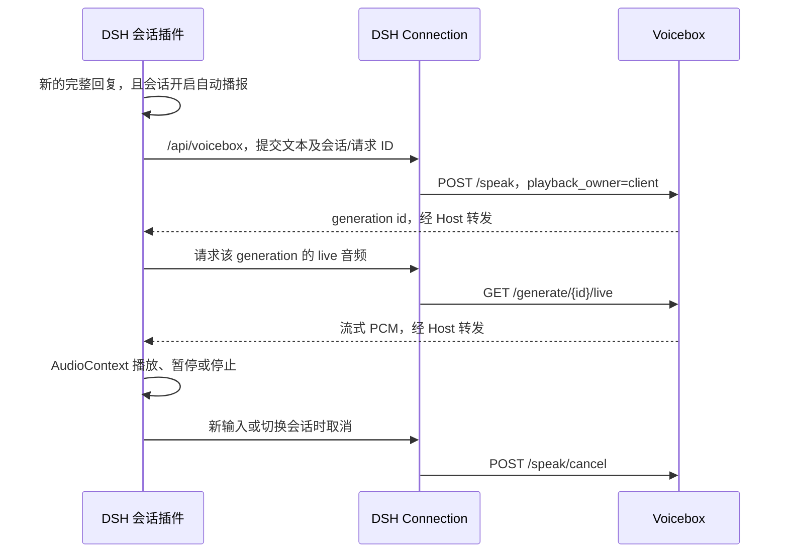

# DSH Voicebox

通过 DSH 官方 Cordis 插件机制，在 DSH Desktop 的对话栏内播放 Voicebox 合成的语音。

## 使用体验

- 每条已完成的 AI 回复下方，在复制按钮旁提供喇叭图标，点击朗读对应回复。会话栏保留自动播报开关。
- 单条回复的按钮状态为喇叭、生成中旋转图标、播放时停止图标；对应回复下方显示播放时间，提供暂停、继续和停止。点击另一条回复会停止之前的播放。
- 自动播报默认关闭，开关按会话保存在当前客户端。
- 自动播报方式可选“完整回复后朗读”或“边回答边读”。前者保留原有行为，后者从当前生成尝试的正文增量中分句，完整句子积累到约 24 字符即开始合成；较长的无标点段落按不超过约 180 字符分段。
- 两种模式均使用 Qwen 流式 PCM。边回答边读跳过推理、工具参数、代码、图片、链接地址及管道表格；未闭合的 Markdown 构造继续等待后续文字。正文可能包含工具调用前可见的说明文字。
- 分句按顺序播放，最多同时保留一个正在播放的任务和一个预取任务；待处理文本最多八批，总朗读上限 10000 字符。回答结束只补齐末尾，不会重新朗读整篇。
- 生成期间，会话栏提供边回答边读的暂停、继续和停止；回答结束后，控制回到对应回复下方。暂停会跨语音片段保留，点击停止后同一轮剩余文字也不再自动播报。
- 如果模型重试、放弃当前生成、正文改写或连接重建，会停止并丢弃本轮未播放的内容；完成后可手动朗读，避免重试从头自动重播。
- 切换 DSH 内部会话、发送新消息或关闭自动播报时停止播放。切到其他应用窗口或最小化 DSH 后，当前选中的普通会话仍会继续自动播报，边回答边读也会继续接收后续正文；切回窗口不会重复朗读。
- 恢复历史、重连、分页加载和子智能体不会自动播报。已加载的历史回复可通过各自的喇叭手动朗读。

## 前提

1. 使用本仓库包含本次集成修改的 Voicebox 后端，已经配置可供 Qwen 使用的音色及模型。
2. `/speak` 的 OpenAPI 必须包含 `request_id`、`stream_audio` 和 `playback_owner`，并提供 `/speak/cancel`。版本号 `0.6.0` 本身不能证明这些能力已安装。
3. Voicebox 后端默认监听 `http://127.0.0.1:17493`。可在插件配置里指定其他地址。

DSH Desktop 负责实际播放；Voicebox 主窗口和悬浮窗不会同时播放这条回复。

## 构建和安装

从 Voicebox 仓库构建客户端，无需安装新的 TTS 引擎：

```powershell
cd D:\Projects\Voicebox\integrations\dsh-voicebox
bun install --ignore-scripts
bun run build
```

在 DSH Desktop 中打开“插件 → 添加插件”，选择本地目录：

```text
D:\Projects\Voicebox\integrations\dsh-voicebox
```

也可以安装打包后的 `dsh-voicebox-0.1.0.tgz`，以目标版本的插件安装器支持的输入为准。首次安装与更新应使用 Desktop 自己的插件入口，不直接修改它的 profile 或内置文件。

安装后，在 Voicebox 设置中为客户端 `dsh-voicebox` 绑定默认音色，或填写插件的 `profile`。打开普通会话，点击“自动播报：关”开启，随后发送一条消息。点击开关或回复下方的喇叭，也会完成浏览器音频权限所需的用户手势。

如果重启客户端后浏览器仍要求手势，点击“朗读”即可重新启用音频。

## 插件配置

在 **插件 → dsh-voicebox → 语音播报设置** 中修改后点击“保存设置”。适配 DSH Desktop 0.2 的官方 `plugins.bundle.config` 插槽及 `configForms`，设置写入当前 DSH profile，重新打开后仍保留。保存会停止当前语音，下一次手动或自动朗读使用新参数。

- **语音模型**：Qwen3-TTS Base 0.6B / 1.7B。
- **自动播报方式**：完整回复后朗读（新安装默认）/ 边回答边读；手动朗读始终读取所选完整回复。
- **声音档案**：从已保存的 Voicebox 后端地址实时读取，保存稳定的档案 ID；可刷新列表，或选择跟随 Voicebox 客户端绑定。当前引擎不支持的设计声音、预设声音显示为不可选。
- **朗读语言**：跟随档案，或显式选择中文、英文等语言。
- **连接与会话范围**：后端地址、客户端标识及会话白名单。

改动先留在表单中，保存时以开始编辑时的配置版本做一次原子写入。其他窗口先修改了配置时，本次保存会拒绝覆盖，并保留草稿。地址变更后请先保存再刷新声音列表。模型下载及声音档案创建仍在 Voicebox 中完成。

首次升级包含宿主代码的插件版本后，需重新启动 DSH；日常参数修改实时生效，无需重启。

| 字段 | 默认值 | 用途 |
| --- | --- | --- |
| `endpoint` | `http://127.0.0.1:17493` | Voicebox 后端地址 |
| `clientId` | `dsh-voicebox` | Voicebox 音色绑定及取消请求的作用域 |
| `profile` | 空 | 指定音色名称或 ID；否则按客户端绑定及默认音色解析 |
| `language` | 空 | 继承音色语言，可显式设为 `zh`、`en` 等 |
| `modelSize` | `0.6B` | `0.6B` 或 `1.7B`，较小模型优先降低等待时间 |
| `readingMode` | `complete` | `complete` 为完整回复后朗读，`streaming` 为边回答边读 |
| `sessionIds` | `[]` | 可选会话白名单；空数组不限制 |

本版本固定使用 Qwen 流式语音，不启用 personality 改写。单条文本上限为 10000 字符，超限会显示错误并跳过，避免静默截断。

## 调用路径



宿主只代理固定操作以及本插件签发的 generation，不提供任意 URL 转发。地址和音色由宿主配置决定。浏览器使用同源请求，Desktop 使用其协议或 transport fetch 通道，无需放开 Voicebox 的 CORS。宿主构建会将配置库打包进 `lib/index.js`，本地目录安装也无需从 Harness 外部解析该运行依赖。

同一自动回复使用稳定的 `session_id/request_id`；后端先持久化预约，再创建任务。重复请求不会创建第二个任务或再次发布 Voicebox 播放事件。取消先停止本地音频，再按客户端和会话取消后端任务；尚未返回的旧请求不会恢复播放。

## 开发验证

```powershell
# 在插件目录
node --test tests/*.test.mjs
bun run build
node tests/host-smoke.mjs <已构建的-deepseek-harness-目录>

# 浏览器交互夹具；模拟 PCM，不调用真实模型
bun scripts/preview-build.mjs
node tests/preview-server.mjs
# 打开 http://127.0.0.1:17781
```

Voicebox 根目录的回归测试：

```powershell
.venv-perf/Scripts/python.exe scripts/run-streaming-tests.py
bun test scripts/tests/agentSpeechPlayback.test.ts scripts/tests/agentSpeechQueue.test.ts scripts/tests/pcmPackets.test.ts
bun node_modules/typescript/bin/tsc -p app/tsconfig.json --noEmit
```

`.venv-perf` 测试入口依赖本机已有的 portable Voicebox 环境；其他开发机可使用安装了项目依赖的 Python 环境直接运行对应的 pytest 文件。

## 验证记录

开发阶段已验证官方 Cordis、Connection 注册/卸载与 Session 事件链路，并在浏览器夹具中验证实际构建包的 PCM 播放、暂停、继续和新输入中断。夹具不验证 GPU 推理、真实音色或已安装 Desktop 的完整端到端行为。

已在本机 DSH Desktop `0.2.0-rc.2` 通过官方插件页面安装并启用。2026-10-16 的真实联调通过：AI 完整回复自动触发 Voicebox Qwen 0.6B 流式生成，生成期间 Desktop 已开始播放；暂停、继续、完整播放结束及停止时取消后台生成均已验证。自动回复的保存音频约 23.87 秒，预热后首包 PCM 约 0.70 秒；首包时间不等于扬声器出声延迟。声音质量仍以人工试听为准。

插件采用会话栏标准 `sessionId`，不依赖旧版 Session list 的 `current` 字段。详细验收范围见 [VERIFICATION.md](./VERIFICATION.md)。
